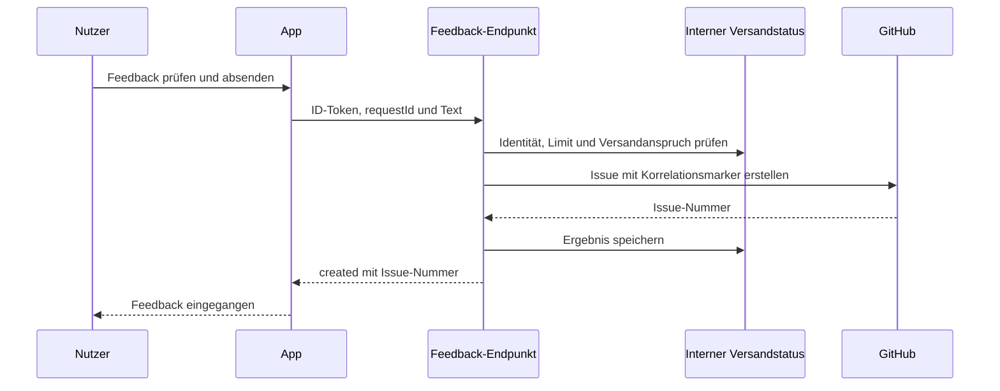

# Feedback aus der App als GitHub-Issue – Umsetzungsplan

Stand: 14. Oktober 2026. Status: Planentwurf, keine Implementierung oder Bereitstellung.

## Ziel und Entscheidungen

Nutzer senden Feedback direkt aus der App. Ein Server erstellt daraus ein Issue
in `DennisAdamski/DSA_HeroApp`; ein GitHub-Konto des Nutzers ist nicht erforderlich.
Erfolg bedeutet: Die App bestätigt eine tatsächlich erhaltene Issue-Nummer.

Vom Nutzer festgelegt: direktes Absenden und Erstellung dieses Plans.
Vorgeschlagener Umfang: Textfeedback ohne Screenshots, Heldendaten oder Logs.
Noch zu entscheiden: nur mit bestehender App-Anmeldung oder auch ohne Anmeldung.
Die Aufgaben unten beschreiben zunächst die Variante mit App-Anmeldung.
Diese Annahme ist keine bereits erteilte Freigabe für eine Loginpflicht.

Die Umsetzung beginnt erst nach Klärung dieser Zugangsentscheidung und Review
dieses Plans. Billing-Aktivierung, Secrets und Deployment sind eigene
Betriebsschritte; dieser Plan führt sie nicht aus.

## Befund im Repository

- `pubspec.yaml`: HTTP, UUID und Firebase Auth sind bereits vorhanden.
- `lib/data/auth_service.dart` und `lib/state/auth_providers.dart`: optionale
  App-Anmeldung; lokale Nutzung ohne Konto bleibt ein eigenständiger Anwendungsfall.
- `lib/data/firestore_rest_client.dart`: HTTP mit Firebase-ID-Token ist bereits
  ein Muster für Windows. Feedback bekommt einen eigenen Transport und wird
  nicht an Heldensynchronisation oder Firestore-REST-Operationen gekoppelt.
- `lib/domain/app_build_info.dart`: vorhandene Versionsinformationen verwenden.
- `lib/ui/screens/settings_screen.dart` und dessen Navigation: gemeinsamer
  Einstieg für die bestehende Oberfläche und Kartograph.
- `firebase.json`: Hosting, Firestore und Storage; noch kein Functions-Codepfad.
- `firestore.rules`: unbekannte Collections sind gesperrt. Interne Feedbackdaten
  kommen außerhalb der benutzerbeschreibbaren `/users/...`-Pfade unter.
- `.github/workflows/flutter-tests.yml`: Flutter-Prüfungen vorhanden,
  Backend-Prüfungen müssen ergänzt werden.

## Architektur und Alternativen

Empfehlung: Flutter → HTTPS-Endpunkt in Firebase Cloud Functions → GitHub REST API.
Ein gemeinsamer HTTP-Client unterstützt Web und Windows, ohne vorauszusetzen,
dass ein neues Callable-Plugin auf jeder Zielplattform verfügbar ist.
Firebase-ID-Tokens werden serverseitig mit dem Admin SDK geprüft.
Firestore speichert ausschließlich den internen Versandstatus und Sendelimits.

Eine Callable Function wäre ebenfalls möglich, erfordert aber vorab einen
Nachweis der unterstützten Zielplattformen bzw. eine Protokollimplementierung.
Ein eigener dauerhafter Server bietet hier zunächst keinen Vorteil gegenüber
der vorhandenen Firebase-Infrastruktur.

## Bedienung und erste Version

1. In den Einstellungen steht ein eigener Bereich „Feedback“ mit dem Button
   „Feedback senden“. Keine zweite Umsetzung innerhalb der Kartograph-Oberfläche.
2. Ein adaptiver, scrollbar aufgebauter Dialog bietet Kategorie
   „Fehler“, „Wunsch“ oder „Regelfrage“, Titel und Beschreibung.
3. Titel: nach Trim 5–120 Zeichen; Beschreibung: 20–8.000 Zeichen.
   Der Server prüft dieselben Grenzen; maximal 32 KiB Request-Body.
4. Vor dem Absenden werden alle übertragenen Angaben angezeigt:
   Text, Kategorie, App-Version, Plattform und Oberfläche.
   Die aktuelle Fachansicht wird nur übertragen, wenn der Aufrufer sie als
   festen, heldenunabhängigen Kontext mitgibt; keine globale Navigationshistorie.
5. Die Vorschau erläutert ausdrücklich, dass Feedback als GitHub-Issue gespeichert
   wird und bei öffentlichem Zielrepository öffentlich lesbar ist.
   Keine E-Mail, UID, Heldennamen oder Inhalte des Heldenspeichers im Issue.
6. Während des Sendens ist der Button gesperrt. Fehler erhalten die Eingaben.
   Erfolgsansicht: „Feedback eingegangen: #123“ mit kopierbarer Referenz.
   Ein öffentlich zugänglicher Link ist optional; bei privatem Repository
   wird kein für den Nutzer erreichbarer Issue-Link versprochen.
7. Ohne Internet bleibt der Entwurf im geöffneten Dialog erhalten; kein
   automatisches Nachsenden und keine neue allgemeine Offline-Warteschlange.

Nicht im ersten Umfang: Anhänge, automatische Fehlerberichte, Export von
Heldendaten, GitHub-Kommentare aus der App und eine Ticketverlaufsansicht.

## API-Vertrag

Ein HTTPS-Handler `feedbackApi` stellt zwei Routen bereit:

| Route | Zweck |
|---|---|
| `POST /submissions` | Neue Einsendung oder Wiederholung derselben Anfrage |
| `GET /submissions/{requestId}` | Versandstatus für die authentifizierte Identität |

Token über `Authorization: Bearer <Firebase-ID-Token>`, JSON über
`Content-Type: application/json`. Keine UID aus dem Request übernehmen.
Request-Felder: `schemaVersion: 1`, UUID `requestId`, `category`
(`bug`, `feature`, `rules`), `title`, `description`, `appVersion`,
`platform`, `surface`, optional `screenContext` aus einer erlaubten Liste.
Version/Plattform/Oberfläche sind untrusted Metadaten und niemals Berechtigungen.
Unbekannte Felder ablehnen; zusätzliche Textfelder begrenzen.

Antworten: `201` bei neuem Issue, `200` bei vorhandenem Ergebnis,
`202` bei `processing` oder `uncertain`, `400` bei ungültigen Eingaben,
`401` bei fehlendem/ungültigem Token, `409` bei gleicher ID mit anderem Inhalt,
`429` bei Sendelimit, `503` bei deaktiviertem oder vorübergehend gestörtem Dienst.
Antwort-JSON enthält `requestId`, `status` und bei `created` die `issueNumber`;
bei Fehlern einen festen `code`, keine GitHub-Antwort oder Stacktraces.
Statuszugriff auf fremde IDs liefert `404`.

Der App-Client bietet `submit(FeedbackSubmission)` und `status(String requestId)`
als `Future<FeedbackResult>` an. ID-Token-Lieferant und `http.Client` sind
injizierbar. Ein Token wird unmittelbar vor der Anfrage gelesen.
`FeedbackResult` unterscheidet `created`, `processing`, `uncertain` und
typisierte Fehler. Ein Timeout ist kein Nachweis, dass kein Issue entstand.

## Sicherheit und Betrieb

- Repository und erlaubte Labels ausschließlich serverseitig festlegen.
  Der Client darf weder Zielrepository noch Issue-Berechtigungen bestimmen.
- Ein auf dieses Repository begrenztes GitHub-Token mit `Issues: write`
  als Secret Manager Secret hinterlegen; nicht in App, Assets, Firestore
  oder Versionskontrolle. Ablauf und Rotation im Betriebsleitfaden dokumentieren.
- Startwerte: höchstens 3 neue Einsendungen je Identität/Stunde und 10/Tag.
  Reservierung und Prüfung atomar in Firestore; Wiederholungen derselben
  Anfrage verbrauchen keine zusätzliche Quote.
- Zusätzlich globales konfigurierbares Tageslimit, deaktivierbarer Dienst,
  begrenzte Instanzzahl und kurze externe Timeouts. Ein Firebase-Konto ist
  kein vollständiger Spam-Schutz; Last und Kosten beobachten.
- CORS erlaubt nur produktive/test Hosting-Origins und explizite Entwicklungs-
  Origins. `OPTIONS` ohne Token bedienen. CORS ersetzt keine Authentifizierung;
  native Clients funktionieren ohne Origin-Header.
- UID nur intern verwenden, keine Feedbacktexte oder Tokens in Betriebslogs.
  Internen Text nach Versand löschen; Status, Hash und Eigentümerzuordnung
  für 30 Tage vorhalten, danach mit einer TTL-Regel bereinigen.
  Wiederholungen über diesen Zeitraum hinaus sind nicht als idempotent zugesichert.
- Eigene globale Collections `feedbackSubmissions` und `feedbackRateLimits`:
  ausschließlich Admin SDK, direkte Clientzugriffe bleiben verboten.
- Functions benötigen den Firebase-Blaze-Tarif. Aktuellen Tarif, Region,
  Kosten und Limits vor der Bereitstellung prüfen; Billing nicht still aktivieren.
- Test und Produktion erhalten getrennte serverseitige Konfiguration.
  Staging erzeugt Issues ausschließlich in einem ausdrücklich gewählten
  Testrepository, das Produktions-Repository bleibt das spätere Ziel.

### Doppelte Issues und unklarer Ausgang

Eine `requestId` gehört zu einer Identität und einem normalisierten Payload-Hash.
Ein Firestore-Claim verhindert parallele POSTs für dieselbe Einsendung.
Ein vorhandenes Ergebnis wird wieder ausgegeben; geänderter Inhalt unter
derselben ID wird abgelehnt. Die App hält die ID bis zur Klärung unverändert.

GitHub und Firestore bilden keine gemeinsame Transaktion. Deshalb erhält jedes
Issue einen unpersönlichen Korrelationsmarker. Nach Timeout oder Absturz
zwischen GitHub-Erstellung und Statusspeicherung gilt der Vorgang als `uncertain`.
Ein abgelaufener Claim darf nicht automatisch einen zweiten POST auslösen.
Der Statuspfad versucht eine begrenzte Suche nach dem Marker; ein Treffer
rekonstruiert das Ergebnis. Ein fehlender Treffer beweist wegen möglicher
Verzögerungen keine Nichterstellung. Bleibt der Ausgang unklar, erfolgt
manuelle Klärung anhand der Referenz. Keine Behauptung einer Exactly-once-Garantie.

Die UI meldet in diesem Fall „Versandstatus noch unklar“ mit „Status prüfen“
und erhält Text und Referenz. Kleine lokale Wiederherstellungsdaten halten
requestId und Status über App-Neustarts; sie werden weder mit Helden synchronisiert
noch beim Logout einem anderen Konto zugeordnet. Gespeicherte Textentwürfe
sind für die erste Version nicht erforderlich.

## Umsetzungspakete

Für die spätere Ausführung den Skill `superpowers:executing-plans` verwenden.
Jedes Paket: zuerst aussagekräftige fehlende Tests, minimale Implementierung,
relevante Tests und `flutter analyze`, danach nur zugehörige Dateien committen.
Alle neuen öffentlichen Dart-APIs erhalten erklärende Dart-Doc-Kommentare.

### P1 – Backend und nachweisbarer Versandstatus

Neue Dateien unter `functions/`: `package.json`, `tsconfig.json`,
`src/index.ts`, `src/feedback/api.ts`, `validation.ts`, `submission_service.ts`,
`submission_store.ts`, `github_issue_client.ts` und entsprechende
`test/feedback/*.test.ts`. Node-/Firebase-Versionen bei Implementierungsbeginn
gegen die unterstützten Laufzeiten prüfen und im Lockfile festhalten.
Ändern: `firebase.json`, `.github/workflows/flutter-tests.yml`.

- [ ] GitHub-HTTP-Client und Firestore-Store über kleine Interfaces injizieren;
  `submit(identity, payload)` und `getStatus(identity, requestId)` testen.
- [ ] Tests für fehlendes Token, ungültige Kategorie, überlange Unicode-Texte,
  unerlaubte Metadaten, fremde Statusabfrage und eingeschränkte CORS-Origins.
- [ ] Tests für parallele gleiche IDs, geänderten Payload, atomare Quote,
  deaktivierten Dienst, GitHub `401/403/429/5xx` und Timeouts.
- [ ] Absturz nach GitHub-Erstellung vor Speicherung simulieren: Wiederholung
  darf keinen zweiten Erstellaufruf auslösen; Markerfund stellt Ergebnis wieder her.
- [ ] Endpoint, Secrets-Konfiguration, festen Issue-Text und internen Store
  implementieren. Nutzertext als Text behandeln, GitHub-Erwähnungen neutralisieren.
  Korrelationsmarker nur serverseitig hinzufügen; serverseitige Labels müssen
  im Zielrepository existieren oder ein dokumentierter Fallback greift.
- [ ] `npm ci`, `npm test`, `npm run build` in `functions/` und Emulatorprüfungen
  für Claims/Quoten ausführen; CI prüft Backend ohne Produktionssecrets.

Abnahme: ein simuliertes Issue erzeugt bestätigten Status; alle obigen
Fehlerfälle sind ohne Zugang zu echtem GitHub testbar.

### P2 – App-Vertrag, HTTP-Client und Wiederherstellung

Neu: `lib/domain/feedback/feedback_submission.dart`, `feedback_result.dart`,
`lib/data/feedback/feedback_client.dart`, `feedback_pending_store.dart`,
`lib/state/feedback/feedback_providers.dart` und
`test/data/feedback/feedback_client_test.dart`, `feedback_pending_store_test.dart`.
Vorhanden verwenden: `authServiceProvider`, Firebase-Bootstrap,
`app_build_info.dart`, `http`, `uuid`. Ein ID-Token-Zugang wird gezielt am
Auth-Service ergänzt, falls dort noch kein geeigneter Zugang existiert.

- [ ] Vertragstests mit `MockClient`: Header, JSON, Response-Validierung,
  Statuscodes, Timeout und Tokenwechsel zwischen zwei Aufrufen.
- [ ] Ergebniszustände und Client implementieren; keinen automatischen POST-Retry
  nach unklarem Ausgang verwenden. Polling nur begrenzt oder nutzerinitiiert.
- [ ] Lokale offene Referenz kontogebunden speichern und nach Neustart laden;
  Konto A darf den Status von Konto B weder laden noch anzeigen.
- [ ] Endpoint über Build-Konfiguration einstellen. Fehlende Konfiguration
  ergibt „Feedback derzeit nicht verfügbar“, niemals ein geratenes Ziel.
- [ ] `flutter test test/data/feedback` und `flutter analyze` ausführen.

Abnahme: derselbe Vertrag funktioniert über HTTP auf Web und Windows;
Neustart und Kontowechsel erhalten sichere Referenzen.

### P3 – Gemeinsamer Feedback-Dialog und Einstellungen

Neu: `lib/ui/feedback/feedback_dialog.dart`, `feedback_page.dart`,
`feedback_result_view.dart` sowie `test/ui/feedback/feedback_dialog_test.dart`.
Ändern: `lib/ui/screens/settings_screen.dart`,
`lib/ui/screens/settings/settings_navigation.dart`.
Regressionsprüfungen: `test/ui/screens/settings_screen_test.dart`,
`test/ui2/shell/karto_settings_guard_test.dart`.

- [ ] Widgettests für Formulargrenzen, vollständige Vorschau, Erfolg,
  Doppelklick, Fehlererhalt, unklaren Status und fehlende Anmeldung.
- [ ] Dialog bei 320 px Breite und großer Textskalierung prüfen;
  alle Felder und Aktionen müssen scrollbar erreichbar sein.
- [ ] Feedback-Seite in beide vorhandenen Einstellungsanordnungen integrieren.
  Die vorhandenen Guards für offene Heldenplanung werden nicht umgangen.
- [ ] Bei ausstehendem Ergebnis Referenz anzeigen und Statusprüfung anbieten;
  kein Erfolgsbanner bei bloßer Annahme oder Timeout.
- [ ] `flutter test test/ui/feedback`, beide genannten Regressionstests und
  `flutter analyze` ausführen.

Abnahme: Textfeedback lässt sich direkt aus beiden Oberflächen senden,
ohne GitHub-Anmeldung und ohne Änderungen an Heldendaten.

### P4 – Dokumentation, Integration und kontrollierter Betrieb

Neu: `docs/feedback_betrieb.md`. Ändern: `README.md`, `CLAUDE.md`,
`docs/technical_overview.md`, `docs/web_deployment.md`; `AGENTS.md` auf
Widersprüche prüfen, nur bei tatsächlich nötiger Policyänderung anpassen.

- [ ] Betrieb dokumentieren: Region, Secrets-Rotation, Limits, Abschaltung,
  Aufbewahrung, unklare Versandfälle und Staging-/Produktionsziele.
- [ ] Firestore-Emulatortest: App-Nutzer können beide internen Collections
  weder lesen noch schreiben; vorhandene Heldenzugriffe bleiben unverändert.
- [ ] `flutter analyze`, vollständige `flutter test`-Suite seriell,
  Backendtests, LOC-Prüfung und Web-Build ausführen. Neue Fehler beheben;
  bestehende Fehler getrennt dokumentieren, keine unbelegte Grünmeldung.
- [ ] Erst nach separater Betriebsfreigabe Staging bereitstellen und einen
  echten Versand in das Testrepository prüfen; Web und Windows manuell testen.
- [ ] Produktionsfreigabe anhand erfolgreicher Staging-Ergebnisse einholen;
  Functions gezielt deployen, keinen pauschalen Hosting-/Rules-Deploy ausführen.
- [ ] Entscheidungen und Grenzen mit Commit in Mempalace hinterlegen.

## Variante ohne App-Anmeldung

Falls gewählt, wird vor P1 das Identitäts- und Missbrauchskonzept erweitert.
Kein stilles `signInAnonymously()` im bestehenden Firebase-Auth-Service:
Authstatus steuert Konto-/Heldensynchronisation und darf nicht durch Feedback
verändert werden. Eine getrennte Feedback-Identität und plattformgerechte
Abwehr (Web etwa App Check, Desktop gesondert prüfen) sind erforderlich.
Anonyme Identitäten sind leicht erneuerbar; Quoten pro Identität allein genügen
nicht. Globale Limits und ein überprüfbarer Schutz gegen automatisierte
Einsendungen müssen vor öffentlicher Freigabe nachgewiesen werden.

## Aufwand und offene Betriebsvoraussetzungen

Grobe Schätzung: 2–4 Arbeitstage für P1–P4 mit App-Anmeldung, abhängig von
Firebase-Billing, GitHub-Berechtigungen und vorhandenen Testproblemen.
Ohne App-Anmeldung zusätzlicher Aufwand für getrennte Identität und Spam-Schutz;
verlässliche Schätzung erst nach Festlegung der Zielplattformen dieses Zugangs.
Screenshots werden als spätere Erweiterung mit eigenem Speicher-/Löschkonzept geplant.

Vor Deployment prüfen: Ist Issues im Repository aktiv, ist es öffentlich oder
privat, darf Feedback dort erscheinen, und welches Testrepository wird benutzt?
Aktueller Blaze-Status und Region wurden für diesen Plan nicht live geprüft.

## Technische Quellen

- [GitHub: Create an issue und erforderliche Berechtigung](https://docs.github.com/en/rest/issues/issues#create-an-issue)
- [Firebase: Functions einrichten, einschließlich Blaze-Voraussetzung](https://firebase.google.com/docs/functions/get-started)
- [Firebase: Secret-Konfiguration](https://firebase.google.com/docs/functions/config-env)
- [Firebase: Callable Functions und Unterschied zu HTTP Functions](https://firebase.google.com/docs/functions/callable)

Die Wahl eines gewöhnlichen HTTPS-Endpunkts und die Aufwandsschätzung sind
Projektentscheidungen dieses Entwurfs, keine Zusagen der verlinkten Anbieter.
